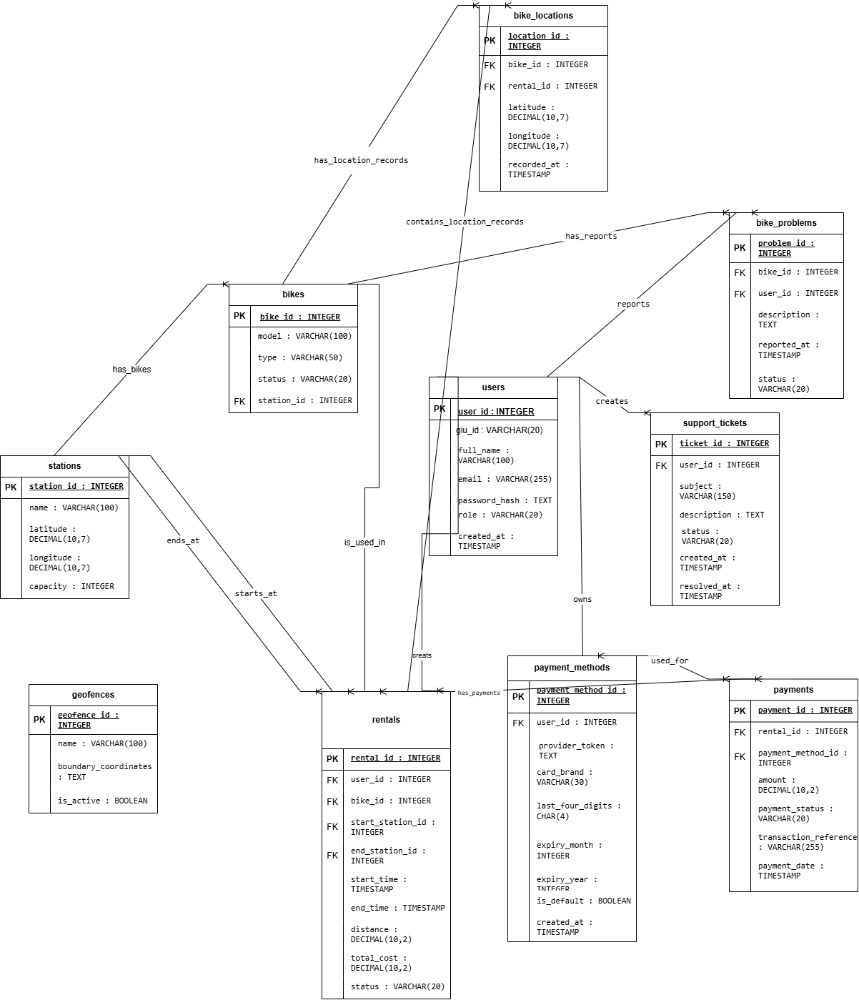

# Smart Bike Rental App

**German International University (GIU)**  
**Software Engineering — Milestone 2: Database Design and Implementation**

---

## 1. Project Overview

The Smart Bike Rental App is a bike-sharing system designed for German International University (GIU) students and staff.

The system provides convenient transportation between the university campus and the monorail station by allowing users to locate available bikes, rent them, track their rides, and make automatic payments.

The application also includes GPS tracking, geographical restrictions, bike problem reporting, and customer support.

### Main Features

- User registration and login restricted to GIU students and staff.
- Live bike availability and location tracking.
- QR code scanning to start bike rentals.
- GPS tracking and geographical boundary enforcement.
- Ride duration, distance, and cost calculation.
- Bike return procedures for campus and monorail locations.
- Payment card registration and automatic payments.
- Faulty bike reporting and availability management.
- Customer support requests and administrative responses.

---

## 2. Team Members

| Name | GIU ID | Role in Team |
|---|---|---|
| Malek Moaz | 19002369 | Team Leader and Project Coordination |
| Mazen Zaki | 19004099 | Requirements Analysis |
| Youssef Marawan | 19002534 | ERD Development |
| Omar Ebeid | 17002289 | Relationships and Cardinalities Review |
| Abdelrahman Gadallah | 19003313 | Database Table Creation |
| Mohamed Elshellity | 19006374 | Constraints and Indexes |
| Youssef Gheith | 19001973 | Sample Data Preparation |
| Zein Ahmed | 19007657 | Database Testing |
| Zeiad Ahmed | 19007457 | Documentation and Traceability |
| Abdelrahman Ehab | 19003060 | GitHub Organization and Final Review |

---

## 3. Entity Relationship Diagram (ERD)

The Entity Relationship Diagram represents the database structure, including its entities, attributes, primary keys, foreign keys, relationships, and cardinalities.

**Editable ERD Source:** [Open erd.drawio](docs/erd.drawio)  

### ERD Preview  
https://drive.google.com/file/d/1GAJG9yBb7PuCrnJlAI1fWz1W1msoQLJZ/view?usp=sharing



---

## 4. Entity-to-User-Story Traceability

The following table maps each database entity to the user stories from the final Milestone 1 product backlog that justify its inclusion.

| Entity | Related User Stories |
|---|---|
| users | US-001, US-002, US-003, US-004 |
| bikes | US-005, US-006, US-007, US-009, US-010, US-028 |
| stations | US-005, US-006, US-020, US-021 |
| rentals | US-009, US-010, US-016, US-017, US-018, US-019, US-020, US-021, US-022, US-023, US-024 |
| payments | US-026, US-027 |
| payment_methods | US-025, US-026, US-027 |
| bike_locations | US-011, US-013, US-014, US-015, US-017, US-022 |
| geofences | US-012, US-013, US-014, US-015, US-020, US-021, US-022 |
| bike_problems | US-028 |
| support_tickets | US-029, US-030 |

---

## 5. Database Information

| Property | Details |
|---|---|
| DBMS | PostgreSQL |
| PostgreSQL Version | 18 |
| Database Name | `smart_bike_rental` |
| Database Administration Tool | pgAdmin 4 |

### Database Design

The database consists of 10 main entities:

1. `users`
2. `bikes`
3. `stations`
4. `rentals`
5. `payments`
6. `payment_methods`
7. `bike_locations`
8. `geofences`
9. `bike_problems`
10. `support_tickets`

The database uses primary keys, foreign keys, unique constraints, check constraints, and indexes to maintain data integrity and establish relationships between entities.

---

## 6. PostgreSQL Scripts

All database scripts are stored in the `schema/` directory.

The scripts should be executed in the following order on an empty PostgreSQL database named `smart_bike_rental`.

| Script | Description |
|---|---|
| `01_create_tables.sql` | Creates all database tables and defines primary and foreign keys. |
| `02_constraints_indexes.sql` | Adds database constraints, validation rules, and indexes. |
| `03_seed_data.sql` | Inserts sample records into the database for testing. |
| `04_database_tests.sql` | Contains separate tests to verify database constraints and data integrity. |

**Note:** The fourth script contains intentional invalid-data tests. It is separate from the normal database setup sequence.

---

## 7. Repository Structure

```text
smart-bike-rental-giu/
│
├── README.md
│
├── docs/
│   ├── erd.png
│   └── erd.drawio
│
└── schema/
    ├── 01_create_tables.sql
    ├── 02_constraints_indexes.sql
    ├── 03_seed_data.sql
    └── 04_database_tests.sql
```

---

## 8. Tools and Technologies

- **PostgreSQL 18:** Relational database management system.
- **pgAdmin 4:** Database administration and SQL execution.
- **draw.io (diagrams.net):** Entity Relationship Diagram design.
- **Git and GitHub:** Version control, collaboration, and project submission.

---

**German International University (GIU)**  
**Software Engineering — Smart Bike Rental App — Milestone 2**
